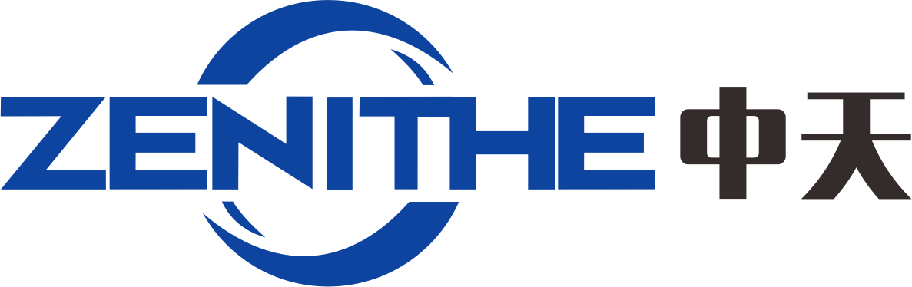

# 企业官网模板 · 使用说明

一套零依赖的静态官网，5 个页面：首页 / 认证项目 / 关于我们 / 新闻资讯 / 联系我们。
纯 HTML + CSS + 原生 JS，**不需要 Node、不需要数据库、不需要装任何东西**。

---

## 一、先看效果

双击 `index.html` 就能在浏览器里打开（推荐 Chrome / Edge）。

> 如果想让手机也能访问预览，在本文件夹打开命令行执行：
> `python -m http.server 8080`，然后手机连同一个 WiFi 访问 `http://电脑IP:8080`。

---

## 二、目录结构

```
company-site/
├── index.html            首页        ← 改首页文案
├── services.html         认证项目    ← 改项目介绍
├── about.html            关于我们    ← 改公司介绍/历程/团队
├── news.html             新闻列表
├── contact.html          联系我们    ← 改地址/表单
├── sitemap.xml           给搜索引擎的地图（记得改域名）
├── robots.txt            爬虫规则（记得改域名）
└── assets/
    ├── css/style.css     全站样式    ← 改配色、间距、圆角
    ├── js/site.js        渲染逻辑    ← 一般不用动
    ├── data/site.js      ★ 全站文字内容都在这（公司名、电话、服务、新闻）
    └── img/favicon.svg   浏览器标签小图标
```

**记住一句话：改文字优先改 `assets/data/site.js`，改版式去对应 `.html`，改颜色去 `style.css` 顶部的 `:root`。**

---

## 三、最常改的 8 件事

### 1. 换公司名、电话、地址、备案号
打开 `assets/data/site.js`，最上面的 `company` 段：

```js
company: {
  name: "华诚认证咨询",          // ← 改成你的公司名
  nameEn: "HUACHENG COMPLIANCE", // ← 英文名（logo 下方小字）
  mark: "华",                    // ← logo 方块里的字，1 个字最好看
  phone: "400-000-0000",         // ← 页面显示的电话
  phoneRaw: "4000000000",        // ← 点击拨号用，去掉横线
  email: "service@example.com",
  address: "广东省东莞市……",
  icp: "粤ICP备00000000号",      // ← 备案下来后换成你的
  ...
}
```

改完保存 → 刷新浏览器。**注意：只改英文引号 `" "` 里的字，别删引号和行尾逗号。**

页脚版权、备案号会自动同步，不用改 5 个 HTML。

### 2. 加减导航菜单
同文件 `nav` 段，增删一行就多/少一个菜单项：

```js
nav: [
  { text: "首页", href: "index.html" },
  { text: "认证项目", href: "services.html" },
  ...
]
```
> 手机端抽屉菜单会跟着自动变。

### 3. 改服务项目 / 认证项目
`services` 段是一组对象，每个对象 = 一张卡片：

```js
{
  icon: "recycle",              // 图标：shield/leaf/globe/award/check/chart/recycle/users
  title: "GRS 全球回收标准",     // 标题
  desc: "再生材料含量核算……",    // 介绍，2 行内最好看
  tags: ["再生含量", "TC 证书"]  // 标签，可留空数组 []
}
```
首页显示前 6 个，服务页显示全部。

### 4. 加一条新闻
`news` 段最前面插一段即可（首页显示前 3 条，新闻页显示全部）：

```js
{
  date: "2026-11-02",
  tag: "政策解读",              // 分类：政策解读/客户案例/行业观察/公司动态
  title: "标题写清楚发生什么变化",
  excerpt: "摘要，一到两句，别超过 60 字。"
}
```

### 5. 改整站配色（30 秒换风格）
打开 `assets/css/style.css` 第 12 行附近：

```css
:root {
  --brand: #0b4a6f;    /* 主色：导航、标题、页脚 */
  --accent: #00a58a;   /* 强调色：按钮、图标、下划线 */
}
```
只改这两个色值，全站按钮、图标底色、渐变、悬停效果会一起变。
> 配色工具：打开 <https://uicolors.app> 选两个颜色，复制 HEX 值替换即可。

### 6. 换 logo
现在 logo 是「色块 + 一个字」的写法，最省事。想换成自己的图片：

把图片放到 `assets/img/logo.png`（建议透明背景、高度 80px 以上），然后在 5 个 HTML 里把

```html
<span class="logo-mark" data-site="company.mark"></span>
```
换成
```html

```
（每个页面顶部和页脚各一处，共 10 处）

### 7. 首页大标题 / 各页文案
直接打开对应 HTML，搜中文就能找到，比如 `index.html` 里的：

```html
<h1>把复杂的认证流程，<br />交给<em>真正懂审核</em>的人</h1>
```
`<em>` 里的字会显示为青绿色，可以改或删掉。

### 8. 表单能真正收到留言
现在点「提交需求」只弹本地提示，**不会发到任何地方**。三种接法，从易到难：

| 方式 | 做法 | 成本 |
|---|---|---|
| Formspree | 注册 formspree.io，把 `<form>` 加 `action="https://formspree.io/f/你的ID" method="POST"`，并删掉 `data-contact-form` 属性 | 免费额度够用 |
| 腾讯问卷 / 金数据 | 干脆把表单区块换成一个嵌入的问卷链接 | 免费 |
| 自己写接口 | 服务器上跑 PHP/Node，接收 POST 发邮件 | 需要服务器 |

---

## 四、上线前的检查清单

- [ ] `site.js` 里公司名、电话、邮箱、地址、备案号都换成真的
- [ ] 5 个 HTML 的 `<title>` / `<meta name="description">` 改成自己的（影响百度收录）
- [ ] `sitemap.xml`、`robots.txt`、各页 `<link rel="canonical">` 里的 `example.com` 换成真域名
- [ ] 表单已接入真实接收方式
- [ ] 手机上看一遍（按 F12 → 切换设备工具栏，选 iPhone 尺寸）
- [ ] 换掉演示用的新闻内容

---

## 五、想要「后台可视化改内容」怎么办

这套模板是「改文件」模式，适合内容不常变的官网。如果以后要多人维护、天天发新闻，有两条升级路：

1. **WordPress**：宝塔面板一键部署，装一个企业主题（Astra / Blocksy 免费），后台点鼠标就能改。代价是要维护 PHP + 数据库，服务器配置至少 2 核 2G。
2. **无头 CMS**：站点仍用这套代码，接 Decap CMS / Strapi，内容存 Git 或数据库，后台改完自动发布。适合懂一点技术又想保留页面质量的情况。

具体部署、买域名、买服务器，见同目录 `部署上线指南.md`。
